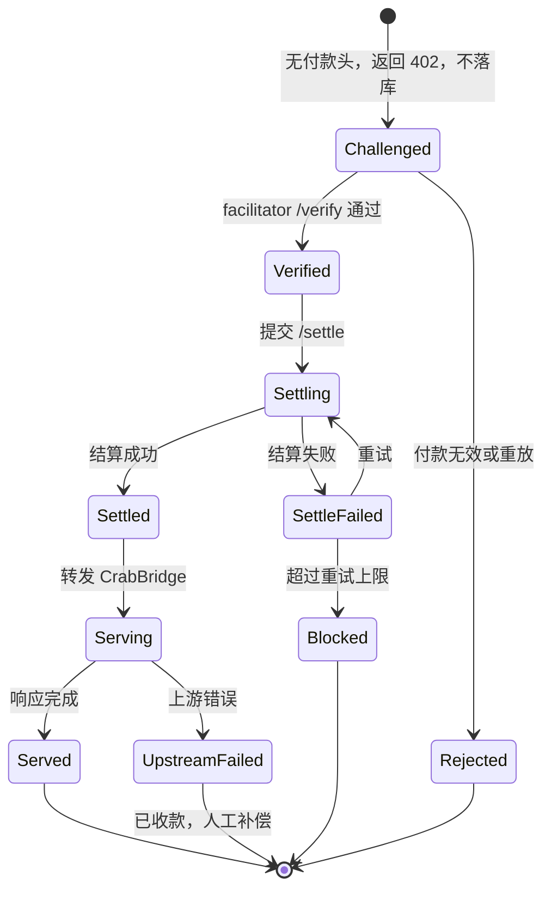
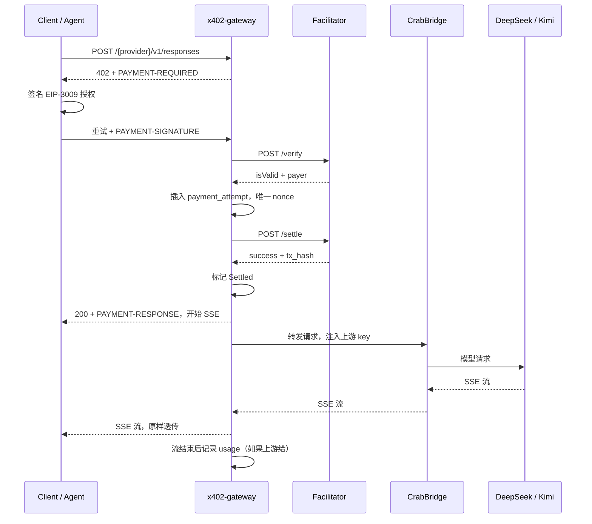

# CrabBridge x402 按次付费网关设计

日期：2026-11-02
状态：待确认
范围：设计稿。只定义形状与验证路径，不改线上代码。
目标读者：维护 0x81 网关、CrabBridge、统一登录的工程师。
现状锚点：本仓库 `1e6477b`（main）。CrabBridge 本地 checkout `d70c580`，与 `origin/main` 一致。

## 1. 决策摘要

一句话：在 CrabBridge 前面加一个独立的 x402 sidecar，让海外开发者和 agent 用 Base 上的 USDC 按次调用模型。MVP 不建账号、不发币、不托管资金。

| 决策 | 结论 |
|------|------|
| 付费层位置 | 独立 sidecar `x402-gateway`。不写进 website-rs，也不先写进 crab-bridge-rs |
| 实现语言 | Rust（Axum 0.8 + SQLx 0.8），静态 musl 二进制。Phase 0 的 release 产物约 5 MB，空载 RSS 约 6 MB |
| 部署入口 | 新子域 `crab-api.0x81.uk` 经 Cloudflare Tunnel 到 sidecar。MVP 不走 website-rs，因为网关会缓冲 SSE |
| CrabBridge 现状 | 本地优先的 Rust 代理，未部署在 0x81 栈里。托管版是新增服务，不是改现有部署 |
| 协议版本 | x402 v2，已对照 `@x402/core` 2.29.0 类型确认。仍接受 v1 的 `X-PAYMENT` 请求头 |
| 收费模型 | 固定价/次，按模型分档，强制 `max_tokens` 上限。Phase 2 再评估预付余额或 `upto` |
| 结算时点 | 先结算、后服务。流式响应的头在开流前就固定了，结算回执只能在那之前拿到 |
| 链与资产 | Base Sepolia USDC（EIP-3009）用于联调；USDT 走 Permit2，需要支持该资产的 facilitator 和网络 |
| 结算 | 外部 facilitator（主网 CDP，测试网 x402.org）。服务端不持私钥 |
| 身份 | 付款地址即身份，不要求登录。0x81 JWT 只用于后台看板，不参与调用 |
| 账本 | 主网必须 Postgres。SQLite 只用于本地和测试网 |
| 客户端 | MVP 面向原生支持 x402 的客户端。Codex 的静态 `env_key` 装不下按请求付款，见 §6.5 |
| 成功标准 | 两周内 10 个不同付款地址、100 次已结算调用、结算成功率 > 99%、零双发 |

## 2. 目标与边界

### 2.1 要解决的问题

一个没有美元信用卡的开发者，或者一个自动运行的 agent，想调用 CrabBridge 后面的 DeepSeek/Kimi。传统做法是注册、绑卡、订阅，这三步都会流失。x402 把付款变成一次 HTTP 握手：请求，402 加价格，钱包签名，重试，拿到结果。

### 2.2 最小验证

只做一个付费 endpoint、一个模型、一个价格、一个收款地址。不做账号、不做订阅、不做退款自动化、不做多链。

### 2.3 不做什么

- 不发币，不做积分，不做 token 激励。
- 不做订阅制。订阅是 Phase 3 的事，且需要账号体系。
- 不做资金托管。MVP 的 USDC 直接进收款钱包，不经过平台余额。
- 不做自托管 facilitator。先用现成的，等量和合规都清楚了再说。
- 不面向中国大陆用户宣传加密支付。

## 3. 现状与接缝

### 3.1 website-rs

- 按 Host 反代，没有路径级路由。新增付费入口要么加新子域，要么把网关升级成 Host 加 Path 路由。
- 网关二进制由 CI 出 release 资产，服务器只运行。加路由后必须发新 tag 或本地交叉编译替换 `bin/website-rs`，否则新域名会落到占位路由，表现是 `/` 返回 200 的 `{"status":"ok"}`。
- **网关会缓冲整个请求体和响应体。** `proxy_request` 用 `to_bytes` 读完整请求，用 `resp.bytes()` 读完整响应，然后重建响应。SSE 经过它就不再是流式。付费模型 API 的主要形态是流式，这一条直接排除了 MVP 走网关。
- 网关会覆盖 `Cache-Control`。成功且无扩展名的路径会被写成 `public, max-age=60, must-revalidate`。付费响应不能被公共缓存。
- 网关会转发所有非 hop-by-hop 头，所以 `PAYMENT-REQUIRED` 和 `PAYMENT-SIGNATURE` 能过。但缓冲和缓存两条已经足够让它不适合做付费入口。
- 支付也不适合写进网关。它没有请求体语义、没有数据库、没有 facilitator 客户端。把计费写进入口，等于让所有流量的故障域变成支付系统。

### 3.2 auth.0x81.uk

- 签发方是 `moyan-backend`，对外域名是 `auth.0x81.uk`。claims 是 `{sub,email,name,status,exp,iat}`，HS256，30 天有效期。
- 每个服务自己验签，共用 `AUTH_JWT_SECRET`。没有 introspection 端点，也没有吊销列表。`/api/auth/me` 不返回 `status` 和 `role`。
- x402 调用不需要 JWT。付款地址就是身份。
- JWT 只在两种场景出现：后台看板登录，以及未来把钱包地址绑定到 0x81 账号。
- **不要用共享 HS256 密钥在 sidecar 里验签。** 共享密钥意味着每个验签方也能签发。一个被攻破的付费服务可以给任意 `sub` 造 token，而且现有 token 没有 `aud`、`iss`、`jti`，便宜产品的 token 会被贵产品接受。支付服务要独立身份，不复用这套信任边界。
- `sub` 是登录身份，不是自然人。同一个人用 Google 和 Kimi 登录会得到两个 `sub`，账号合并表不存在。钱包绑定如果要跨登录方式，得先解决这个问题。
- `X-Admin-Token` 是共享的静态根凭据，无身份、无审计，浏览器端持有。不要把它当成改价或提现的唯一凭据。MVP 的改价走配置文件加部署，后台只读。

### 3.3 CrabBridge

- CrabBridge 是本地优先的 Rust 代理，代码在 `rust-infra/crab-bridge-rs`，不在这个仓库。它接 OpenAI Responses API（Codex 说的协议），翻译成上游 Chat Completions，支持 DeepSeek、Kimi 和自定义 base URL。
- 路由是 `/{provider}/v1/responses`、`/{provider}/v1/models`、`/{provider}/v1` 和 `/health`。流式是 Responses SSE，上游是 Chat SSE，代理逐块翻译。
- **它没有部署在 0x81 的 compose 栈里。** `crab.0x81.uk` 只是静态落地页。托管一个付费 CrabBridge 是新增服务：新镜像、新卷、新域名、新进程。
- **客户端 Bearer 现在就是上游 key。** `handle_responses_inner` 把 `Authorization: Bearer …` 原样转给 DeepSeek/Kimi，`ProviderRuntime` 里没有服务端 key。托管版必须反过来：客户端凭证只用于付款，sidecar 换入运营方自己的上游 key。这一步不改 CrabBridge 也能做，sidecar 在转发前替换 `Authorization`。
- `/admin`、`/admin/api/sessions/{id}` 和 `/metrics` 默认无鉴权，session 详情会返回完整对话。公开部署必须由 sidecar 挡掉这些路径，不能透传。
- session 只按 `response_id` 存，没有付款人字段。任何人拿到 `previous_response_id` 就能续别人的对话。付费层要把 `response_id` 绑到付款地址，不匹配就拒绝。
- 请求体上限被关掉了，上游客户端也没有超时。sidecar 要自己设 1 MB 上限和超时，不能依赖 CrabBridge。
- 响应缓存只对非流式生效，缓存键包含 API key。换成服务端 key 后缓存会跨付款人共享。付费入口直接关掉缓存。

### 3.4 现有计量

- 墨言和职演都有 usage 表，但它们是产品内配额，不是资金账本。两张表都只是 `(user_id, day, turns_used)` 的每日计数器，没有单次调用记录、没有 token 数、没有金额、没有状态。
- 现有配额是**调用前扣减，失败不退**。客户端超时重试会再扣一次，因为没有幂等键。付费网关不能复制这个顺序，否则重试就是重复收费。
- 现有代码没有 API key、余额、账本、定价表、流式计量或对账。支付这条线是全新的，不复用配额表。
- 可复用的只有两个模式。第一，按用户隔离。第二，`type_mistake_entries` 的唯一主键把“同一事件只记一次”下沉到数据库。支付账本照这个思路做，唯一约束放在数据库层。

## 4. 为什么是独立 sidecar

| 方案 | 优点 | 代价 | 结论 |
|------|------|------|------|
| A. 写进 website-rs | 所有流量一个入口 | 网关变业务服务，支付故障影响全站，Rust 发布链重，没有数据库，而且会缓冲 SSE | 否 |
| B. 写进 crab-bridge-rs | 最懂请求和流式响应 | 支付与代理耦合，回滚影响代理，Rust 侧 x402 生态不确定 | 暂缓 |
| C. 独立 sidecar | 故障隔离，语言自由，独立发布，先验证再合并 | 多一跳，多一个部署单元 | **选 C** |

sidecar 的边界要窄。它不解析模型输出，不做 token 计费（MVP 固定价），不存 prompt。它只认识 HTTP 方法、路径、`model`、`max_tokens`、付款头，以及 `response.created` 和 `response.completed` 两个 SSE 事件。

如果验证期结束、量起来了，再把计费逻辑收进 crab-bridge-rs，sidecar 退化成薄代理或直接删除。这是有意的临时架构，不是永久分层。

## 5. 协议事实与版本锚点

### 5.1 v2 握手

1. 客户端请求付费资源，不带付款头。
2. 服务端返回 `402 Payment Required`，响应头 `PAYMENT-REQUIRED` 携带 base64 编码的付款要求，包括 scheme、network、asset、amount、payTo、resource 和有效期。
3. 客户端选择一项要求，构造付款 payload，重试原请求，带 `PAYMENT-SIGNATURE` 头。
4. 服务端把 `paymentPayload` 和**服务端自己生成的** `paymentRequirements` 发给 facilitator 的 `/verify`。
5. verify 通过后，服务端先调用 `/settle`，结算成功再处理请求。
6. `/settle` 返回交易哈希，服务端在响应头里回传结算结果。

x402 的常规顺序是 verify、服务、settle。这里改成先 settle，原因是流式响应的 HTTP 头在开流前就固定了，结算回执没有办法在流结束后再塞回头里。固定价又让金额在服务前就确定，所以先结算没有额外的定价问题。代价是每次调用多几秒链上确认，上游失败时钱已经收了。这个取舍在 §7.2 展开。

v1 的差异是付款要求放在 402 响应体的 `accepts[]`，付款头叫 `X-PAYMENT`。MVP 只做 v2，因为新客户端和官方 SDK 都在往 v2 走。要兼容老客户端时，再在 sidecar 里加一层 v1 解析，不改变内部模型。

### 5.2 精确付款（exact）

- EVM 上的 `exact` scheme 用 EIP-3009 `TransferWithAuthorization`。付款人签一张包含 `from`、`to`、`value`、`validAfter`、`validBefore`、`nonce` 的授权，facilitator 代为提交。
- 服务端不碰私钥，也不碰链。签名验证和上链都由 facilitator 做。
- 金额是原子单位字符串。Base USDC 有 6 位小数，`$0.002` 写作 `"2000"`。
- 授权有有效期。服务端必须在 `validBefore` 之前完成 verify 和 settle，否则这笔钱作废。

### 5.3 事实来源

v2 的 wire 已对照官方 `@x402/core` 2.29.0 类型定义确认：

- `PaymentRequirements` 用 `amount`、`asset`、`payTo`、`maxTimeoutSeconds`、`extra`，不再有 `maxAmountRequired`。
- 402 的 `PAYMENT-REQUIRED` 头放完整的 `PaymentRequired`，其中包含 `resource` 和 `accepts`。
- 客户端付款 payload 必须带 `accepted`，facilitator 从 `paymentPayload.accepted.scheme` 读要求。
- facilitator `/verify` 和 `/settle` 的请求体是 `{x402Version, paymentPayload, paymentRequirements}`。

实现时先用真实 facilitator 的 `/verify` 做一次签名探针，确认 wire 和 EIP-712 domain。剩余风险在 facilitator 的资产和网络支持，不在字段名。

### 5.4 USDT 与 Permit2

USDT 不支持 EIP-3009，不能用 `authorization` 签名。x402 的 `exact` 方案对这类 ERC-20 使用 Permit2：

- 付款 payload 里是 `permit2Authorization`，包含 `from`、`permitted.token`、`permitted.amount`、`spender`、`nonce`、`deadline` 和 `witness.to`。
- 服务端校验 token、金额、收款地址和 deadline，facilitator 负责验签和上链。
- 付款要求的 `extra` 写 `{"assetTransferMethod":"permit2"}`；EIP-3009 资产写 `{"name":"USDC","version":"2"}`。
- 网关配置是资产无关的：`X402_ASSET`、`X402_ASSET_SYMBOL`、`X402_ASSET_DECIMALS`、`X402_ASSET_TRANSFER_METHOD`、`X402_NETWORK`。
- 公共 `x402.org` facilitator 的 `exact` 只列出 `eip155:84532`，默认资产是 USDC。真实 USDT 结算需要支持 USDT 的 facilitator 和网络，或自托管 facilitator。

价格和账本金额都叫 `*_atomic`，不再绑定 USDC。

## 6. 收费模型

### 6.1 为什么 MVP 用固定价/次

exact scheme 在服务前就确定金额。LLM 的成本却随输入输出 token 变化。两个办法：按最大可能成本定价，或者按实际用量结算。MVP 选前者，因为：

- 客户端只需一次签名，不需要余额、退款、对账。
- 不需要按 usage 计费。流式响应里的 token 数只用于事后算毛利，不参与定价。
- 最坏成本有上界：强制 `max_tokens`，价格按上界算。

代价是短回答时毛利更高，长回答时可能亏。用 `max_tokens` 上限和模型分档把亏损封住。

### 6.2 定价公式

```text
price_atomic = ceil(
  max(
    min_fee_microusdc,
    (input_tokens_est * input_price + max_tokens_cap * output_price) * (1 + markup)
  )
)
```

- `input_tokens_est` 用请求体字节数除以 3 估算，向上取整。中文和代码会偏保守，宁可多收一点。
- `max_tokens_cap` 是这一档允许的最大输出 token，服务端强制。
- 价格以 micro-USDC 整数存储，避免浮点。
- 每个模型一档。同一模型可以按 `max_tokens` 分小档和大档。

示例数字只用于说明，不是报价：

| 模型档 | 输出上限 | 单价 | 上游最坏成本 | 毛利 |
|--------|----------|------|--------------|------|
| deepseek-chat / 4k | 4096 | $0.004 | $0.002 | 50% |
| kimi-k2 / 8k | 8192 | $0.012 | $0.007 | 42% |

上线前用上游真实价格重算，并把计算过程写进配置注释。

### 6.3 请求约束

- `model` 必须在价格表里，否则 400。
- `max_tokens` 缺省时注入该档上限。超过上限时拒绝，不静默截断。
- 请求体上限 1 MB。超过直接 413，不进入付款流程。
- 只允许 `POST` 到白名单路径。其它路径免费或 404。

### 6.4 Phase 2 的两个选项

| 选项 | 做法 | 适合 | 代价 |
|------|------|------|------|
| 预付余额 | x402 充值，API key 调用，按 token 扣减 | 高频用户、团队 | 托管资金、退款、对账 |
| `upto` scheme | 授权上限，按实际结算 | 想保持非托管 | 依赖客户端和 facilitator 支持 |

MVP 不选，但账本字段要留出 `pricing_model` 和 `authorized_amount`，避免以后改表。

### 6.5 客户端兼容性：Codex 装不下按请求付款

CrabBridge 的主要客户端是 Codex。截至设计时，Codex 的 `model_providers` 配置只有一个静态 `env_key`，启动时从环境变量读一次。x402 的付款 payload 是每次请求单独签名的 EIP-3009 授权，不能塞进静态环境变量。所以纯 x402 按次付费和 Codex 的现有接入方式不兼容。如果新版 Codex 支持按请求注入自定义头，这条结论要重看。

三条路：

| 路径 | 做法 | 优点 | 代价 |
|------|------|------|------|
| 本地签名代理 | Codex 指向 localhost 的小程序，它给每个请求加付款头再转发 | 保持非托管，按次付款 | 用户本机要管钱包，门槛高 |
| 预付余额加 API key | 用 x402 充值一次，拿到 `cb_...` key，Codex 用它做 `env_key`，服务端按次扣余额 | 对 Codex 用户最顺 | 余额账本、API key、退款、托管 |
| 只服务原生 x402 客户端 | agent 框架、脚本、自己写 HTTP 的开发者 | 两周能验证 | 不覆盖现有 Codex 用户 |

MVP 选第三条，因为验证期只验证支付轨道，不引入余额和 key 体系。但要说清楚：CrabBridge 现有用户主要是 Codex 用户，MVP 的付费数据不能直接证明 Codex 用户愿意付费。如果 Codex 是主要假设，应该直接做第二条，把固定价改成按次扣余额。

决策点：验证期结束前访谈 5 个 Codex 用户，问他们是否愿意先充值 5 USDC 换一个 key。愿意的人多，就把预付余额提前到 Phase 2 之前。

## 7. 数据形状与状态机

### 7.1 表

```sql
create table price_rules (
  id                bigserial primary key,
  model             text not null,
  upstream          text not null,
  max_output_tokens integer not null,
  price_atomic   bigint not null check (price_atomic > 0),
  min_fee_microusdc bigint not null default 0,
  pricing_model     text not null default 'fixed',
  active            boolean not null default true,
  created_at        timestamptz not null default now(),
  unique (upstream, model, max_output_tokens)
);

create table payment_attempts (
  id               bigserial primary key,
  request_id       text not null unique,
  payer            text not null,
  network          text not null,
  asset            text not null,
  nonce            text not null,
  amount_atomic bigint not null,
  pay_to           text not null,
  status           text not null,
  payload_hash     text not null,
  valid_before     timestamptz not null,
  tx_hash          text,
  invalid_reason   text,
  created_at       timestamptz not null default now(),
  verified_at      timestamptz,
  settled_at       timestamptz,
  unique (network, asset, payer, nonce)
);

create unique index payment_attempts_one_inflight
  on payment_attempts (payer)
  where status in ('verified', 'settling', 'settled', 'serving');

create table usage_events (
  id              bigserial primary key,
  request_id      text not null references payment_attempts(request_id),
  model           text not null,
  upstream        text not null,
  input_tokens    integer,
  output_tokens   integer,
  price_atomic bigint not null,
  status          text not null,
  upstream_status integer,
  latency_ms      integer,
  created_at      timestamptz not null default now()
);

create table session_owners (
  response_id text primary key,
  payer       text not null,
  created_at  timestamptz not null default now()
);
```

`payment_attempts` 是资金真相，`usage_events` 是产品真相。MVP 一笔付款对应一次请求，拆开是为了 Phase 2 的一笔充值对应多次调用，不用重写账本。

`payload_hash` 是原始 `PAYMENT-SIGNATURE` payload 的 sha256。日志记它，不记完整签名。

### 7.2 状态机



关键选择是**先结算、后服务**。三个原因：

1. 流式响应的 HTTP 头在开流前就固定了，结算回执只能在开流前拿到。流结束后再结算，回执没有地方放。
2. 固定价在服务前已经确定，先结算不会出现“先收多少”的问题。
3. 未结算敞口为零。不会出现服务完了却收不到钱的情况。

代价是每次调用多几秒链上确认，而且上游失败时钱已经收了。缓解办法：

- facilitator 返回 `settle` 成功就开流，不等最终确认。最终确认由对账任务补。
- 上游失败记录 `upstream_status`，人工补偿或记欠款。退款自动化不做。
- 低价值请求可以配置成 verify、服务、异步 settle，回执走 `GET /v1/payments/{request_id}`。这是 Phase 2 的优化，不是 MVP。

同一个付款地址仍然同时只允许一个进行中的请求。数据库用部分唯一索引保证：`payer` 在 `verified`、`settling`、`settled`、`serving` 状态里只能有一行。新请求返回 429，直到前一笔结束。这样同一地址不会并发打爆上游，也不会出现两笔未完成的付款。

### 7.3 幂等与重放

- `(network, asset, payer, nonce)` 唯一。插入冲突就是重放，直接 409，不再调用上游。这个约束放在数据库层，和现有 `type_mistake_entries` 用主键保证“同一事件只记一次”是同一个思路。
- 客户端超时重试必须重新签名，生成新 nonce。同一个 nonce 不会服务两次。
- 现有配额是调用前扣减、失败不退、重试再扣。付费网关改成：先确认付款有效，再结算，再服务。客户端重试由 nonce 唯一约束挡住，不会重复收费。
- 上游失败但已结算：MVP 不退，记录 `upstream_status`，人工补偿。退款自动化是 Phase 2。
- 进程崩溃：`Verified`、`Settling`、`Settled` 和 `Serving` 状态的行由启动时的 reconciler 处理。超过 `validBefore` 且未结算的标记 `Expired`。已结算但未服务的标记 `Orphaned`，人工退款或补偿。未结算且未过期的重新提交结算。

## 8. 请求流程



要点：

- 402 响应不缓存，`Cache-Control: no-store`。
- 转发时不缓冲响应体。SSE 必须逐块透传。
- 请求体只读一次。解析 `model` 和 `max_tokens` 后重新组装转发，或先缓冲再转发。1 MB 上限让缓冲可接受。
- 上游凭据由 sidecar 注入，客户端永远看不到。
- 客户端断开时，继续读完上游或主动取消。固定价已定，取消不退款。记录 `client_disconnected`。

## 9. 与现有系统的集成

### 9.1 入口与网关

- 新子域 `crab-api.0x81.uk`，一级子域。不要用 `api.crab.0x81.uk`，那是两级，`*.0x81.uk` 的 Universal SSL 和 Origin 证书都覆盖不到，和旧 `admin.moyan.0x81.uk` 是同一个坑。
- 宿主机 443 已经被 website-rs 占用，sidecar 不能再绑同一个端口。MVP 用 Cloudflare Tunnel 把 `crab-api.0x81.uk` 指到 sidecar 的本地端口，TLS 在 Cloudflare 边缘终止，origin 只监听 localhost。这样不抢 443，也不用再管一张证书。另一个选择是把 sidecar 放到单独一台机器。不要为了这个去改 website-rs 的监听端口。
- 如果不用 Tunnel，也可以在前面放一台 Caddy 做 SNI 分流，但那要把 website-rs 挪到内部端口，改动面比 Tunnel 大。MVP 不选。
- **不走 website-rs 的路由。** 三条硬约束。第一，网关用 `resp.bytes()` 缓冲整个响应，SSE 会被攒完才发。第二，网关把成功且无扩展名的响应改写成 `public, max-age=60, must-revalidate`，付费响应会被公共缓存。第三，网关对命中的代理请求没有访问日志，支付审计没有原料。
- 如果以后要把 API 收回网关，先做四件事：响应体改成流式转发，付费路由强制 `no-store`，补代理路径的访问日志，加请求体上限和上游超时。做完再谈路由。这是独立的工作，不是本设计的 MVP。
- Cloudflare 侧只允许 HTTPS。origin 端口不暴露公网，只让 Tunnel 或本机访问。明文传付款头可以被重放。
- 不要在 compose 里发布 CrabBridge 的 `11435`。只让 sidecar 能访问它。否则付费层可以被绕过。
- 验证入口是否生效，用 `POST` 打一个付费路径，例如 `/{provider}/v1/responses`，不带付款头。应该返回 402，不是 404，也不是 200 的占位 JSON。不要只看 `/`。
- 浏览器客户端需要 CORS。`Access-Control-Allow-Headers` 要包含 `PAYMENT-SIGNATURE`，`Access-Control-Expose-Headers` 要包含 `PAYMENT-REQUIRED` 和结算响应头。`OPTIONS` 预检不能收费。
- SSE 不能被缓存或缓冲。确认 Cloudflare 不缓存 `text/event-stream`，sidecar 不聚合响应体。

### 9.2 鉴权

- 付费调用不读 JWT，只读付款头。
- 管理接口不复用 `AUTH_ADMIN_TOKEN` 做资金操作。MVP 只开一个只读看板，用独立的 `X402_ADMIN_TOKEN`，和产品后台的根凭据分开。
- 看板（Phase 2）用 0x81 JWT 登录，用 `sub` 绑定钱包地址。绑定用 SIWE 签名，不用邮箱验证码。绑定表要允许一个 `sub` 绑多个地址，也要记录一个地址是否已被其它 `sub` 占用。
- 现有 JWT 用户如果要免付款调用，走 `Authorization: Bearer` 分支，由 `sub` 查内部额度。MVP 关闭这个分支，避免两套计费同时上线。将来要开，也不要用共享 HS256 密钥验签，改用短 TTL 的专用 token 或 introspection。

### 9.3 CrabBridge

- CrabBridge 的公开形态是 OpenAI Responses API 代理，路径按上游分：`/{provider}/v1/responses`、`/{provider}/v1/models`、`/{provider}/v1`，支持 SSE 流式。`provider` 是 `deepseek`、`kimi` 或配置里的 slug。
- sidecar 的上游地址通过 `X402_UPSTREAM_URL` 配置，不写死。
- 只代理白名单路径。`/admin`、`/admin/api/sessions/*`、`/metrics` 一律 404，不透传。这些路径默认无鉴权，session 详情会返回完整对话。
- 转发前把客户端的 `Authorization` 换成运营方的上游 key。CrabBridge 现在把客户端 Bearer 原样当上游 key 用，托管版不能这样。客户端 key 不落到 CrabBridge。
- `previous_response_id` 要绑付款人。sidecar 从 SSE 的 `response.created` 事件里拿到 `response_id`，写入 `session_owners(response_id, payer)`。下一次请求带 `previous_response_id` 时查这张表，付款人不一致就 403。不做这一步，任何人都能续别人的对话。
- 关掉 CrabBridge 的响应缓存。缓存键包含 API key，换成服务端 key 后会跨付款人共享。付费入口不需要这层缓存。
- sidecar 设 1 MB 请求体上限和上游超时。CrabBridge 的 body limit 是关的，reqwest 客户端也没有超时，不能依赖它。
- 流式响应逐块透传，不聚合。CrabBridge 的 SSE 是 Responses 事件，sidecar 只解析 `response.created` 和 `response.completed` 两个事件，分别用于绑定 session 和记录 usage。其它事件原样转发。
- 给 CrabBridge 一个数据卷存 `data/crabbridge.db`。它自己的 SQLite 用 WAL 和 `synchronous(NORMAL)`，只放 session，不放账本。

### 9.4 部署

- 新增两个服务。`crabbridge` 用 `rust-infra/crab-bridge-rs` 的镜像，挂一个 `data/` 卷，**不发布端口**。`x402-gateway` 用 Rust（Axum + SQLx）静态 musl 二进制，和 website-rs 同一套构建方式。
- 对外不暴露端口。Cloudflare Tunnel 指向 sidecar 的本地端口，TLS 在 Cloudflare 边缘终止。如果改用独立主机或 SNI 分流，再按 §9.1 的取舍处理证书。
- sidecar 的环境变量：`X402_FACILITATOR_URL`、`X402_PAY_TO`、`X402_NETWORK`、`X402_ASSET`、`X402_UPSTREAM_URL`、`X402_UPSTREAM_AUTH`、`X402_DATABASE_URL`、`X402_ADMIN_TOKEN`。收款地址和上游 key 只放服务端。
- 主网账本用 Postgres（Supabase 或自建）。测试网可以用 SQLite，但要知道现有 SQLite 配置是 `synchronous(NORMAL)`，掉电可能丢最后一笔事务。账本不接受这个设置。
- 现有 Rehearse 的 Postgres 路径是仓库里唯一经过并发测试的持久化实现，可以参考它的连接池和 Supabase pooler 处理。但它的设计前提是“库里没有不可重建的数据”，支付账本不满足这个前提。备份和 PITR 要单独设计。
- 迁移不要放在启动路径上。Rehearse 的教训是新库没跑迁移时 `/health` 仍然 ok，业务接口全报 `no such table`。支付服务要么显式跑迁移，要么启动时检查 schema 版本并拒绝服务。
- 健康检查 `GET /health`：DB 可写，facilitator `/supported` 可达，结果缓存 60 秒。健康检查不要打付费路径。
- 不把收款私钥放进服务。服务端没有私钥。
- 支付表每天备份，保留 30 天，比产品库更严。

## 10. 安全、合规与失败模式

### 10.1 付款校验

- 服务端自己生成 `paymentRequirements`，只把客户端 payload 和它一起送 facilitator。绝不使用客户端回传的要求。
- 校验 payload 里的 `scheme`、`network`、`asset`、`payTo`、`amount` 与服务端要求一致。
- 拒绝过期授权，`validBefore` 小于当前时间加 30 秒缓冲。
- 金额用整数比较，不解析浮点。
- 同一个 nonce 只服务一次。唯一约束在数据库层，不在应用层。

### 10.2 滥用与故障

| 故障 | 行为 |
|------|------|
| verify 超时 | 503，不服务 |
| settle 超时或失败 | 同一授权重试是安全的，EIP-3009 nonce 防双花。重试 3 次，仍失败则拉黑地址并告警 |
| settle 成功但响应丢失 | 按 nonce 查结算状态，不重复服务 |
| 上游 5xx | 已结算的记账，人工补偿。未结算的不结算 |
| 客户端重复提交 | 409，不再调用上游 |
| 402 洪水 | 按 IP 限流。402 本身不产生成本，但会消耗 CPU |
| 价格配置错误 | 启动时校验价格大于 0、模型唯一、上限大于 0。不合法拒绝启动 |

### 10.3 托管面的额外风险

- CrabBridge 的 `/admin`、`/admin/api/sessions/*`、`/metrics` 默认无鉴权。sidecar 必须挡掉，不能靠 CrabBridge 的“只给 localhost 用”的假设。
- session 是全局的。不绑付款人，`previous_response_id` 就是跨租户能力。`session_owners` 表是必需的，不是可选项。
- 响应缓存会跨付款人共享。付费入口关掉缓存。
- CrabBridge 的请求体上限是关的，上游客户端没有超时。sidecar 必须自己设上限和超时，否则一个慢上游能占住付款请求。
- compose 里不要发布 CrabBridge 的端口。只让 sidecar 访问。所有 0x81 服务当前都发布了端口，网关不是硬边界，防火墙要配合。
- Cloudflare 侧只允许 HTTPS，origin 端口不暴露公网。明文传付款头可以被重放。
- 上游 key 只存在 sidecar 环境变量里。客户端传来的 `Authorization` 在转发前丢弃。
- 流式中途失败：已经结算的请求不回滚，记录 `upstream_status` 和 `stream_incomplete`，人工处理。

### 10.4 合规

- 非托管、按次付费的 API 访问，通常不构成资金传输。这是判断，不是法律意见。上线前找律师确认司法辖区。
- 对付款地址做制裁名单筛查，例如 OFAC 名单。可以先用静态名单，量起来再接服务商。
- 记录每笔收入、`tx_hash`、付款地址，用于税务和对账。
- 不记录 prompt 和 completion 正文。只记录 token 数、模型、状态、延迟。
- 上游模型条款是 go/no-go 门槛。确认 DeepSeek/Kimi 允许转售 API 访问。不允许就不能做这个生意，换供应商或换模式。

### 10.5 不做什么

- 不做资金池，不做收益，不做杠杆。
- 不接受非 USDC 资产，不做跨链桥。
- 不承诺退款 SLA。文档写清楚上游失败人工处理。

## 11. 可观测性与运维

指标：

- `x402_challenges_total{path,model}`
- `x402_verify_total{result}`
- `x402_settle_total{result}`
- `x402_revenue_microusdc_total{model}`
- `x402_settle_latency_seconds`
- `x402_upstream_errors_total{upstream,status}`
- `x402_inflight_unsettled{payer}`，用来发现卡住的付款
- `x402_session_mismatch_total`，跨付款人续对话的次数
- `x402_blocked_path_total{path}`，被挡掉的 admin 和 metrics 探测

日志字段：`request_id`、`payer`、`model`、`price_atomic`、`status`、`tx_hash`、`latency_ms`。不记正文。

sidecar 是付费入口，访问日志由它自己写。website-rs 对命中的代理请求没有访问日志，不能指望它提供支付审计。

告警：

- 结算失败率超过 1%，5 分钟窗口。
- facilitator 不可达超过 2 分钟。
- 单个地址的未结算请求超过 5 分钟。
- 收入突降 50%，可能是配置或路由坏了。

对账：每天把 `payment_attempts` 里 `Settled` 的记录与 facilitator 或链上交易对一遍，差异告警。

## 12. 两周验证计划

| 天 | 做什么 | 通过标准 |
|----|--------|----------|
| 1-2 | sidecar 骨架、价格表、402 响应、mock facilitator 单测 | 单测覆盖 402、verify、重放、结算失败 |
| 3-4 | 本地托管 CrabBridge，接一个 provider。Base Sepolia 端到端：真钱包、真 facilitator、x402 原生客户端 | 一笔 $0.001 流式调用完成 verify 和 settle，SSE 不被缓冲 |
| 5 | session 绑定、admin 和 metrics 挡掉、请求体上限、超时、重复 nonce | 跨付款人的 `previous_response_id` 返回 403 |
| 6-7 | 主网一个模型、一个价格、文档和示例 | 内部用真钱跑通 10 次 |
| 8-14 | 投放 x402 和 agent 开发者社区，同时访谈 5 个 Codex 用户 | 10 个不同地址、100 次已结算调用 |

停止条件：两周内没有 10 个付费地址，说明需求不成立。不要加功能续命，回到访谈或换方向。Codex 用户如果普遍要求“先充值换 key”，把预付余额提到下一阶段，而不是继续打磨按次付款。

**真测试网记录（2026-11-02）**：Base Sepolia + 真实 `x402.org` facilitator 已跑通一次 0.001 USDC 结算，tx `0xe165fbcc6b71a40274dedbc30d688421da7fe807948ce01f821aab39cc7357bd`。网关返回 200，账本 `status=served`，付款方 20 → 19.999 USDC，收款方 0 → 0.001 USDC。Permit2 真实 `/verify` 也已通过，返回 `permit2_insufficient_balance`，说明 USDT 签名和 wire 正确；USDT 结算只差 payer 的测试 USDT 和少量 Base Sepolia ETH。

## 13. 实现骨架（Rust）

Phase 0 的实现是 `x402-gateway/` 下的 Rust crate，Axum 0.8 + SQLx 0.8 + SQLite。模块边界：

- `src/config.rs`：`X402_*` 环境变量解析和校验。
- `src/x402/wire.rs`：付款要求、payload、`PAYMENT-REQUIRED` / `PAYMENT-SIGNATURE` 编解码。所有未核实的 v2 字段名都集中在这里。
- `src/x402/facilitator.rs`：`Facilitator` trait 和 HTTP 实现。`/verify` 不重试；`/settle` 对 5xx、429 和传输错误重试 3 次。
- `src/store.rs`：SQLx SQLite 账本。唯一 nonce、每付款人单笔在途、状态迁移和启动清理都在这里。
- `src/api.rs`：Axum 路由、402/200/409/429 响应、CORS、请求 ID 和访问日志。
- `src/bin/migrate.rs`：`sqlx::migrate!` 迁移，独立二进制。
- `src/bin/mock_facilitator.rs`：离线 `/supported`、`/verify`、`/settle`。

关键类型：

```rust
pub struct PriceRule { model, price_atomic, max_output_tokens, active }
pub struct PaymentAttempt { request_id, payer, network, asset, nonce, amount_atomic, pay_to, status, payload_hash, valid_before, ... }

pub trait Facilitator: Send + Sync {
    async fn verify(&self, payload: &PaymentPayload, reqs: &PaymentRequirements) -> Result<VerifyResult, FacilitatorError>;
    async fn settle(&self, payload: &PaymentPayload, reqs: &PaymentRequirements) -> Result<SettleResult, FacilitatorError>;
    async fn supported(&self) -> Result<Vec<Kind>, FacilitatorError>;
}
```

`PaymentRequirements` 由价格表生成，不接受客户端输入。facilitator 只做 HTTP，不碰私钥。

请求处理的固定顺序：

1. `OPTIONS` 直接 204，不收费。
2. 路径不在白名单，404。
3. 读取请求体，上限 1 MB。解析 `model` 和 `max_tokens`。
4. 查价格。模型不存在，400。`max_tokens` 超上限，400。
5. 没有付款头，返回 402 和 `PAYMENT-REQUIRED`。
6. 有付款头，解析 payload，调用 `Verify`。
7. 插入 `payment_attempt`，唯一 nonce 冲突就 409。
8. 调用 `Settle`。成功才进入下一步。
9. 丢弃客户端 `Authorization`，注入运营方 key，转发 CrabBridge。
10. 透传 SSE，旁路解析 `response.created` 和 `response.completed`，分别绑定 session 和记录 usage。

## 14. 开放问题

1. CrabBridge 的托管部署。镜像、`data/` 卷、provider 配置、上游 key 归属都要定。代码在 `rust-infra/crab-bridge-rs`，不在这个仓库，部署是本设计的前置条件。
2. x402 v2 的结算响应头名称和 facilitator 字段，需要对照官方规范逐项核对。
3. CDP facilitator 的主网准入、费率、可用性。如果拿不到，是否自托管。
4. DeepSeek/Kimi 的转售条款。
5. 收款主体和税务辖区。
6. 是否需要在 `0xindex` 上加入口，还是只放在 `crab-web` 文档里。
7. 钱包地址和 0x81 账号的绑定关系。`sub` 按登录方式分裂，同一个人可能有两个账号。绑定表要不要允许合并，合并由谁批准。
8. 支付服务的吊销与风控。现有 JWT 没有吊销列表，`status` 是 30 天前的快照。付款地址的黑名单要独立维护，不能依赖 `users.status`。
9. 流式计量。MVP 固定价，不按 token 收费。Phase 2 如果按 token 收费，要决定用 `upto` 还是预付余额，还要处理客户端中途断开和上游不给 `usage` 的情况。
10. API key 的形态。仓库里没有现成的 key 表、哈希方案、轮换或吊销。如果做预付余额，这部分是全新的。
11. 账本持久性。现有 Rehearse 的 Postgres 路径可以复用连接和迁移模式，但备份、PITR、fsync 策略要重新定。SQLite 的 `synchronous(NORMAL)` 不能用于主网账本。
12. Codex 的付费路径。是让用户跑本地签名代理，还是直接做预付 key。这决定 MVP 之后是继续做 x402 原生接口，还是转向余额体系。
13. 入口拓扑。Cloudflare Tunnel、独立主机、SNI 分流三选一。Tunnel 改动最小，但多一个常驻进程和一条外部依赖。选定后不要再混用证书和端口方案。
14. 顺带发现：website-rs 现在会把所有成功的无扩展名响应改写成 `public, max-age=60, must-revalidate`，包括带 `Authorization` 的 `/api/auth/me` 和 `rehearse.0x81.uk` 的接口。这是既有的隐私问题，和本设计无关，但应该单独修。修法是保留上游的 `Cache-Control`，或者对带鉴权的路由强制 `no-store`。
